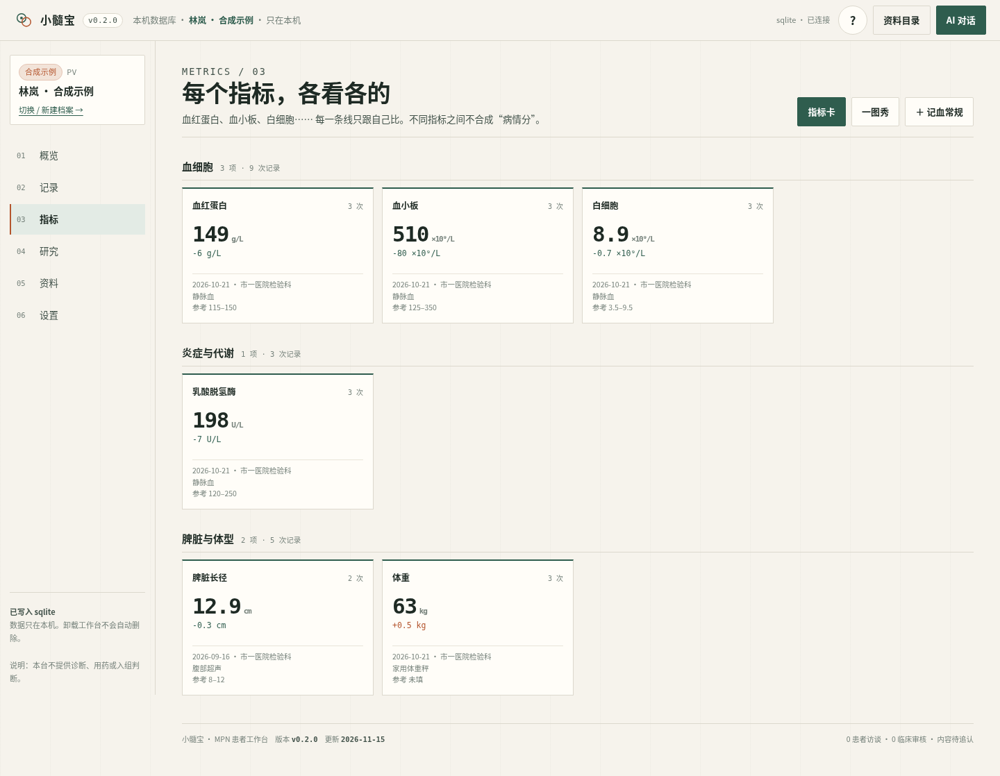
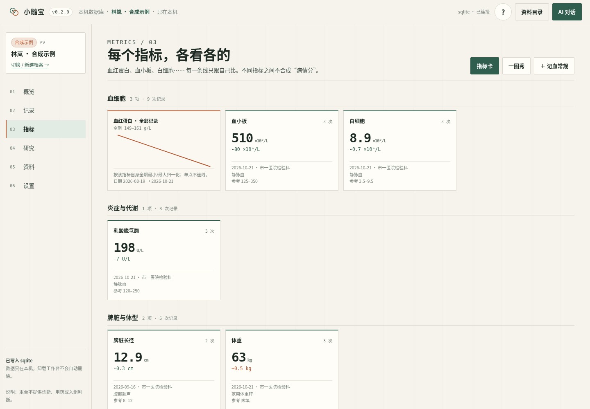
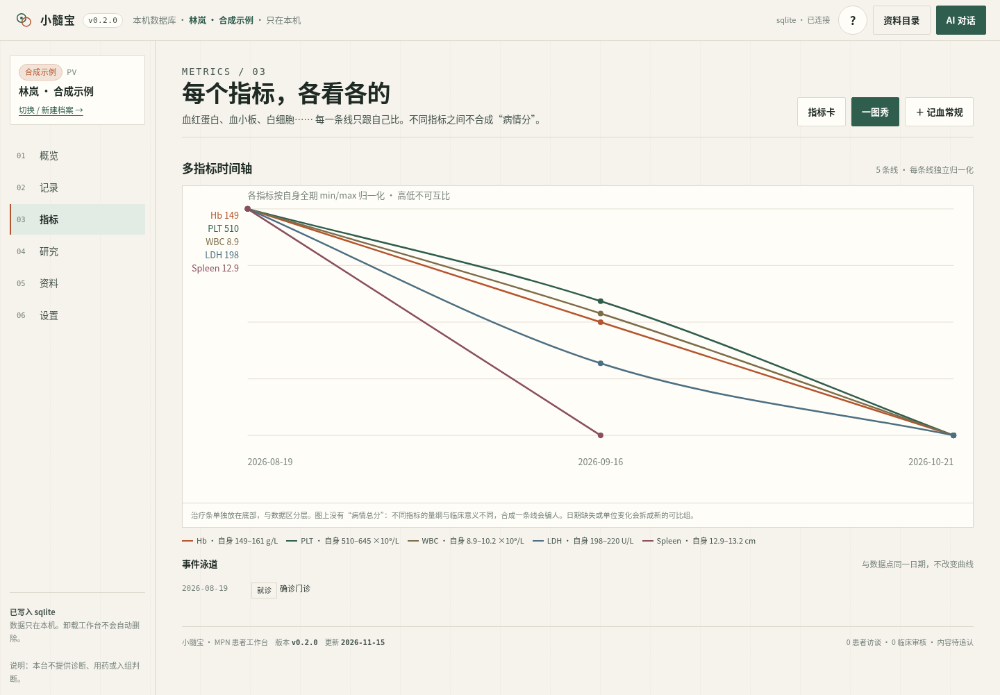
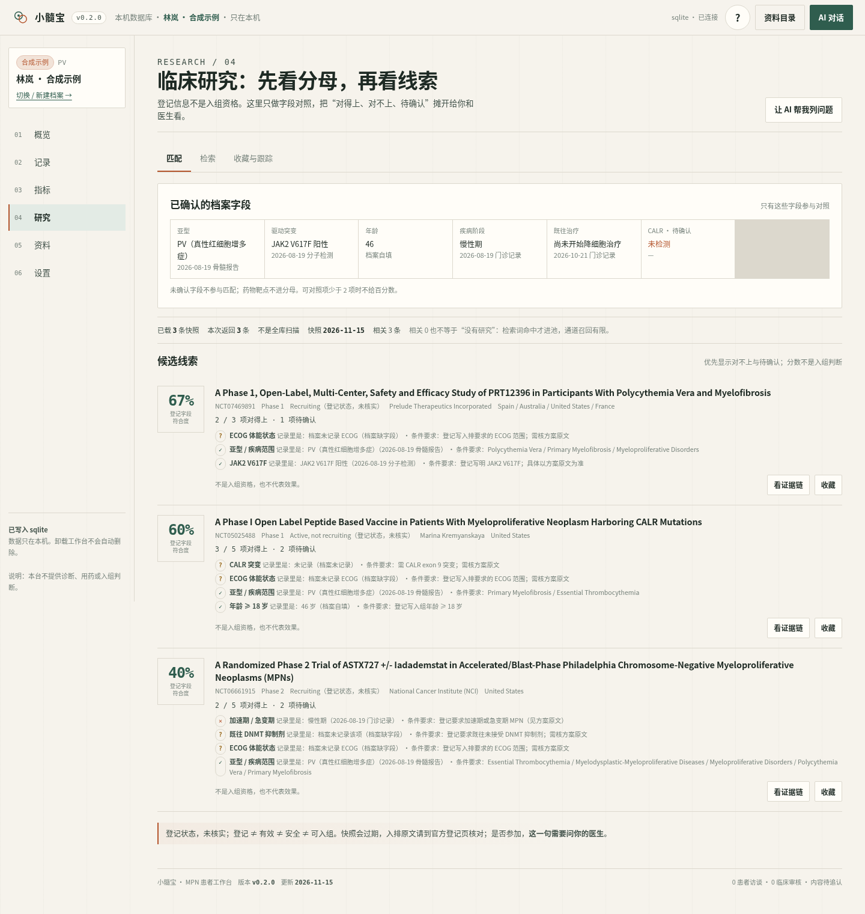
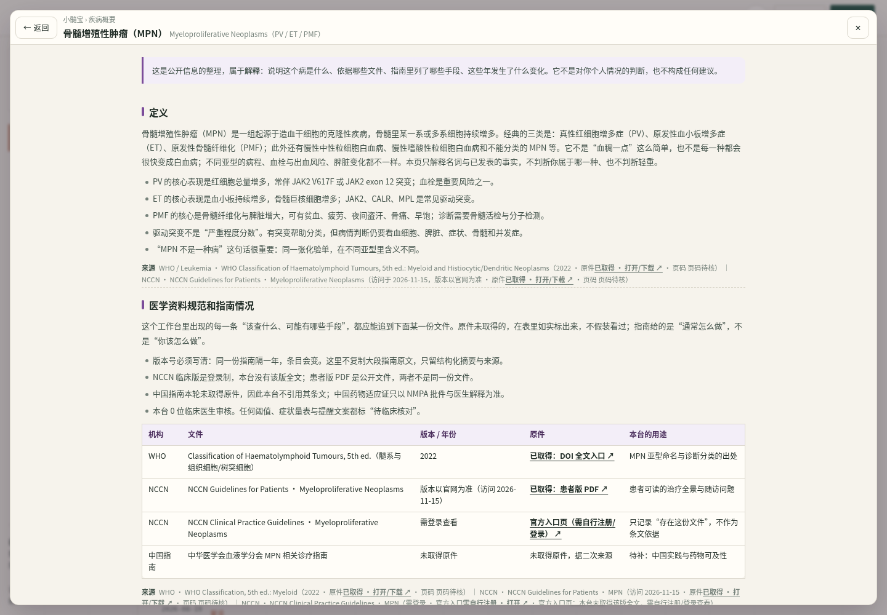
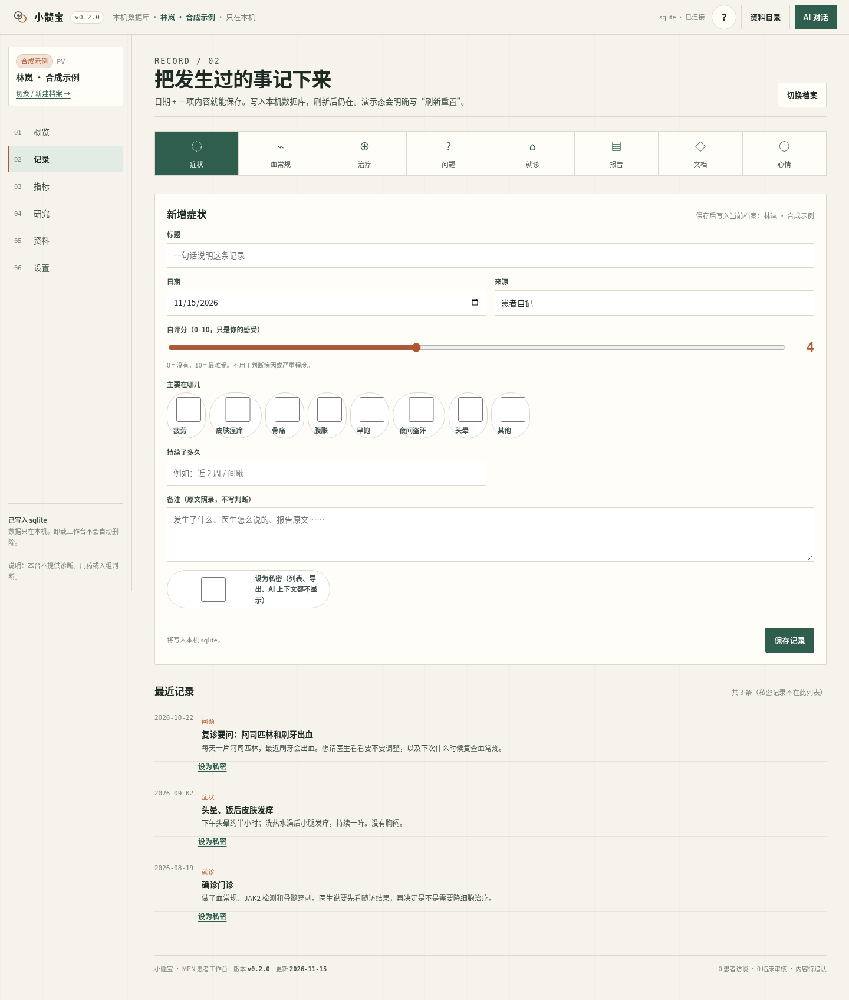
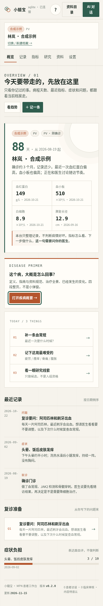

# 小髓宝 MPN 患者工作台

面向骨髓增殖性肿瘤（MPN，含 PV / ET / PMF）患者与照护者的病程记录、指标趋势、症状负担与临床研究信息工作台。

- 品牌：**小髓宝**（家族占位名，**待用户追认**）
- 版本：`0.2.0`（`VERSION` / `package.json` / `lib/version.js` / 页面徽标同源）
- 原型：`prototypes/v0.2/`（HTML 先行合同）；生产版：`public/` + `dsh/`（逐字节 parity）
- 证据边界：**0 位患者访谈 · 0 位临床医生审核**；所有阈值、提醒与医学文案待临床核对
- 数据边界：仓内只有合成示例；**真实患者数据不进仓、不进报告**

## 疾病概要

本台顶栏「?」与首页状态卡两个入口，打开同一份整页疾病概要。四段固定顺序；每段带来源，趋势段只写已发生事实。实现在 `prototypes/v0.2/primer-data.js` + `primer.js` + `primer.css`，面板 DOM 由 `primer.js` 运行时创建为 `#disease-primer`。来源、原件取得情况与页码待核项见 [docs/DISEASE-PRIMER.md](docs/DISEASE-PRIMER.md)。

### 定义

MPN 是一组造血干细胞克隆性疾病，经典三类为 PV / ET / PMF；解释名词与分类，不判断个人病情。

### 医学资料规范和指南情况

列出 WHO 2022 分类、NCCN 患者版 PDF（已取得）与 NCCN 临床版入口（需登录，未取得全文）；中国指南原件本轮未取得，如实标注。

### 目前治疗全景概要

按受累器官与病情轻重列出观察、降细胞、JAK 抑制剂、贫血/脾脏支持、移植与临床研究等类别；不写剂量、不排优劣。固定出口是「选哪一个，这一句需要问你的医生」。

### 发展趋势

只写已发生事实：WHO 第 5 版（2022）、ICC（2022）、FDA momelotinib 批件（2023-09）、CTV 语料截止日（2026-10-05）与本轮检索终态（2026-11-15）。

## 关键功能

- **两套合成档案**：A「PV 刚确诊」记录少、B「PMF 长期随访」记录与指标多；切换后首页状态、指标、症状、复诊问题整页联动，不串档。可另建 `is_demo=0` 的「我的档案」，从空记录开始。
- **8 类记录**：症状 / 血常规 / 治疗 / 问题 / 就诊 / 报告 / 文档 / 心情，全部走 `POST /api/mpn/...` 落 sqlite，刷新仍在；私密记录在列表、导出、AI 上下文三处过滤。
- **指标趋势**：按指标类别分组；单指标趋势按该指标全期 min/max 归一化，单点不连线；3D 卡片固定高度翻面；一图秀把多指标与治疗/事件泳道分层，移动端轨道 `minmax(0,1fr)`。
- **临床研究四段**：已确认档案字段 → 检索（按条件排、不掺分）→ 匹配（`pct = 符合 ÷ 已对照`、待确认按 0、可对照 <2 不给百分数、四档分层）→ 收藏/拒收（拒收零副作用）。卡头写明「已载 N / 返回 M / 不是全库扫描 / 快照日期」。
- **疾病概要整页**：四段顺序固定、每段带来源；返回与关闭两个独立入口；Esc 与浏览器返回只退一层；关闭后焦点回触发按钮、滚动位置不变。
- **设置三 tab**：工作区（资料目录 / 隐私 / 导出 / 关于）、文档解析（MinerU，未接入且勾选与保存不联网）、临床数据库（逐通道终态，FAILED 不算查过）。
- **原生 AI 面板**：customFrame 下用 `ownsSession(currentSession())` 判归属，`service.newSession(workspaceId)` 创建，订阅会话变化；草稿只填入、不自动发送。

## 实渲截图

以下均为本仓 `prototypes/v0.2` 在 Chromium 154.0.8037.57 1440×1000（移动端 390×844）的实渲截图，不是设计稿；**装机后的界面未验证**（本机无 DSH Desktop）。

| 首页 | 指标卡 | 卡片翻面 |
| --- | --- | --- |
|  |  |  |

| 一图秀 | 临床研究匹配 | 疾病概要整页 |
| --- | --- | --- |
|  |  |  |

| 记录表单 | 390 宽 |
| --- | --- |
|  |  |

## 怎么用

本地开发预览（不需要 Desktop）：

```bash
npm install
npm run dev            # http://127.0.0.1:4173/prototypes/v0.2/index.html
# 或只跑生产版：http://127.0.0.1:4173/api/mpn/ui/index.html（数据 .dev-data/）
```

探针（真实 Chromium，必须指向本仓原型）：

```bash
node scripts/probe-mpn-m2.mjs --url http://127.0.0.1:4173/prototypes/v0.2/index.html
CHROME_PATH=/usr/bin/chromium node scripts/probe-disease-primer.mjs \
  --url http://127.0.0.1:4173/prototypes/v0.2/index.html
CHROME_PATH=/usr/bin/chromium node scripts/probe-disease-primer.mjs --self-test   # 必须红（exit 2）
```

装机（**未验证 · 待 MacBook 装机环节**）：`npm pack` 后用 DSH Desktop 的 profile 安装；本机没有 Desktop，只做了 tgz 内容与解出副本的静态扫描（见 `docs/DEV-PLAN.md` M6 与 DAY-REPORT）。

## 数据与口径

- 合成数据唯一源：`prototypes/v0.2/demo-data.js`；服务端种子读同一份（装包回退 `public/` 同字节副本），页面不写死数字。
- schema：`schema/0001_initial.sql` + `schema/freeze-contract.md`（sha256）；判读列 0 命中；结构变更只能新增 `000N_*.sql`。
- 试验快照：`research/mpn-2026/`（manifest / jsonl / sqlite 三方计数与 hash 对账）。3 条是「这些通道在这组检索词下返回了 3 条」，**不是全球全库扫描**；ChiCTR / ICTRP 当轮 FAILED 原样记录，**FAILED ≠ 0 条**。
- 分级只做「对照 CTCAE v5.0」的派生展示，不落库、不写成诊断；没有绝对数值界限的项不启用。
- 登记状态一律「登记状态，未核实」；登记 ≠ 有效 ≠ 安全 ≠ 可入组。
- 0 访谈、0 临床审核；「这一句需要问你的医生」是固定出口。

## 开发与验收

需要 Node.js 22+（本机 v24.22.2）。家族一致性：`npm run audit` 当前 `40/40 通过 · 0 失败 · 0 待人工`。

```bash
npm run check      # 语法 + 装包合同 + 五件门禁 + 面板契约 + schema + 单测
npm test           # 13/13
npm run audit      # 家族一致性
npm run release:check
npm pack           # M6 产物；tgz 不进 git
```

五件门禁（每件均带 `--self-test` 反向对照能力）：

```bash
node scripts/check-data-dir.mjs .
node scripts/check-trial-chain.mjs .
node scripts/check-patient-create.mjs .
node scripts/check-trial-snapshot.mjs .     # 有快照必须对账，不用 --if-present
node scripts/check-trial-matching.mjs .
```

**静态检查 / tgz 打出来 / 代码 push 都不等于装上。** Desktop 实机加载、退出重开、三条点击（AI 对话 / 配置目录 / 新建我的档案）一律「未验证 · 待 MacBook 装机环节」。

需求见 [BRIEF](docs/BRIEF.md)，规格见 [SPEC](docs/SPEC.md)，任务与交接见 [TASKS](docs/TASKS.md)，里程碑见 [DEV-PLAN](docs/DEV-PLAN.md)。开发纪律先读 [AGENTS](AGENTS.md)。

感谢小x宝社区、DataElement 社区，以及 sam / hhx / 繁华的 ❤️ 贡献。初始化来源记录见 `.dsh-wb-starter.json`；许可证与发布策略由维护者确认（当前 private / UNLICENSED）。